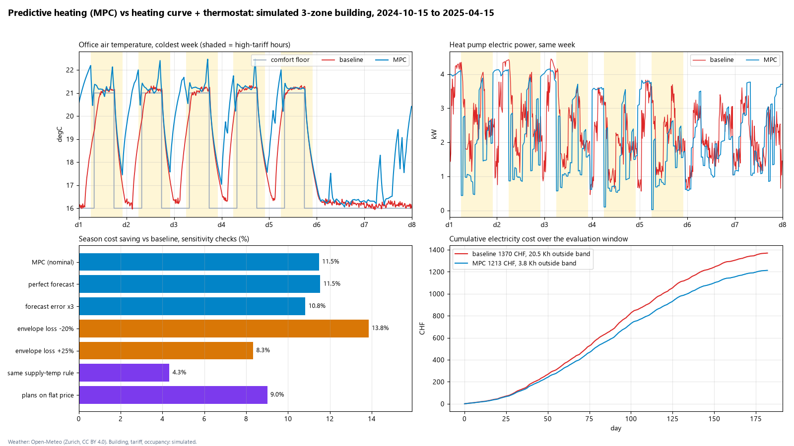
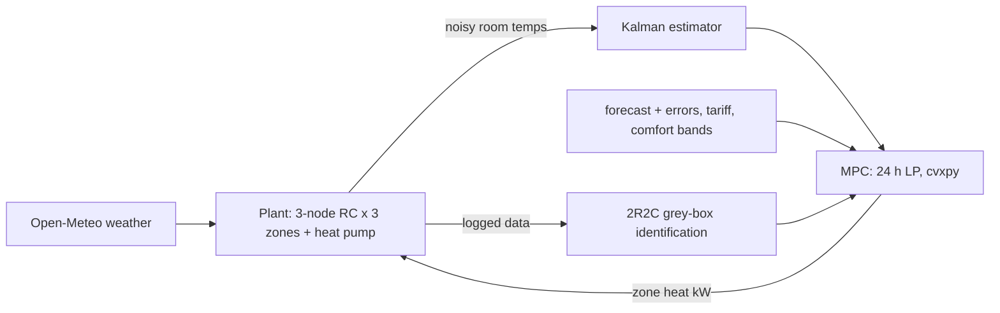

# building-mpc-heating

Open-source predictive (MPC) heating control for a multi-zone building, measured honestly against a tuned heating-curve + thermostat baseline: **-11.5 % electricity cost, -4.5 % kWh** over a simulated Zurich heating season, not the 20-40 % often quoted for "AI heating".



## What it does

* **Plant**: pure-Python RC thermal model of a 3-zone building (living, bedroom, office), 3 nodes per zone, with a
  heat pump (Carnot-fraction COP that depends on outdoor and supply temperature). It is deliberately richer than the
  controller's model, with random daily internal-gain and solar variation, so the identified model is structurally wrong.
* **System identification**: fits a 2R2C grey-box model (21 parameters) to noisy room-temperature data by multi-step
  least squares, reports fit error.
* **Controllers**: (a) weather-compensated heating curve + proportional room thermostats with night setback and a fixed
  pre-heat lead; (b) MPC: a 24 h linear program (cvxpy + CLARABEL) every hour, with a Kalman state estimator, weather
  forecast with errors, occupancy comfort bands, and a two-rate tariff.
* **Metrics**: electricity (kWh), cost (CHF), comfort violation (Kh outside the band, true room temperature),
  peak power, MPC compute time per step.
* **Interfaces**: CLI, a small REST server (`POST /plan`), and a generic MQTT/BACnet-style [point list](docs/POINT_LIST.md).

## Results

Zurich, 2024-10-15 to 2025-04-15 (182 days, 3 days warm-up excluded). Weather real, building/tariff/occupancy simulated.
Raw numbers: `results/results.json`.

| Case | Electricity kWh | Cost CHF | Comfort Kh outside band | Peak kW | Seasonal COP |
|---|---:|---:|---:|---:|---:|
| Baseline (curve + thermostat, setback, tuned) | 5904 | 1370.1 | 20.5 | 4.45 | 3.61 |
| Baseline, constant setpoint (no setback) | 6375 | 1467.1 | 47.9 | 4.23 | 3.60 |
| **MPC** | **5639** | **1212.9** | **3.8** | **4.15** | **3.84** |

MPC vs tuned baseline: cost **-11.5 %**, electricity **-4.5 %**, thermal energy +1.5 %. Over three random seeds
(gains, sensor noise, forecast errors) the cost saving was 11.48 / 11.48 / 11.49 %. MPC solve time per step:
mean 22.9 ms, p95 62.9 ms, max 159 ms (single core, laptop).

Why only 11.5 %, and where it comes from:

| Variant (MPC vs same baseline) | Cost saving | Comfort Kh (MPC) |
|---|---:|---:|
| Nominal | 11.5 % | 3.8 |
| Plant uses the same supply-temperature rule as the baseline | 4.3 % | 4.8 |
| MPC plans as if the tariff were flat | 9.0 % | 3.5 |
| Perfect weather forecast | 11.5 % | 0.3 |
| Forecast error x3 | 10.8 % | **53.9** |
| Building loses 20 % less heat than modelled (baseline 2.7 Kh) | 13.8 % | 0.3 |
| Building loses 25 % more heat than modelled (baseline 224.5 Kh) | 8.3 % | 62.3 |

Reading it honestly:

* About 7 of the 11.5 points come from the plant letting the MPC command heat directly (low supply temperature,
  higher COP). With the heat pump forced onto the same heating-curve supply temperature, the saving is 4.3 % in cost
  and electricity use actually rises 1.9 %. Part of the cost saving also comes from shifting load to the cheap tariff
  (planning on a flat price loses about 2.5 points).
* The tuned baseline is not a straw man: its offset and pre-heat lead were grid-searched (`bmpc tune`, results in
  `results/tuning.json`, tuning fortnight 2024-11-04..18) for the cheapest setting with at most 1 Kh violation.
  An untuned baseline (shorter pre-heat) is cheaper but violates comfort by tens of Kh.
* MPC needs a 0.3 K planning margin above the comfort floor. Without it, sensor noise and model error produce about
  20 Kh per fortnight of small violations.
* Forecast quality matters for comfort more than for cost: tripling the forecast error keeps the saving but breaks
  the comfort band. Model mismatch hurts the baseline more in absolute comfort terms (the baseline has no model to
  be wrong), but the MPC also degrades.

Identification (`results/results.json`, key `identification`): 16 days training + 5 days held-out, sensor noise 0.1 K.
Training RMSE 0.14 K, held-out free-run RMSE 0.24 K versus the noise-free truth. As a 24 h predictor started from room
temperatures only (envelope temperature unknown), RMSE is 1.4 K mean (max 1.95 K), which is why the estimator and the
margin matter.

## Quick start

```bash
python -m venv .venv && . .venv/bin/activate    # Windows: .venv\Scripts\activate
pip install -e ".[dev]"
python -m bmpc demo --smoke --out smoke_out     # one winter week, about 1 minute
python -m bmpc demo --out results --docs-dir docs   # full season, about 18 minutes, reproduces the tables above
python -m bmpc tune                             # re-run the baseline/MPC tuning grid
python -m bmpc figures --out results --docs-dir docs
python -m bmpc plan request.json                # one planning call from JSON
python -m bmpc serve --port 8080                # REST: POST /plan, GET /health, GET /model
pytest -q -p no:asyncio && ruff check .
```

CI runs lint, the tests and the one-week smoke demo. The full season is run locally and the results are committed.
Re-running `demo` should reproduce the cost and kWh numbers exactly (fixed seeds); timings vary by machine.

## How it works



* MPC objective: sum over 24 h of `price * Q_total / COP` plus 5 CHF per Kh of comfort slack. Constraints: the
  identified model, 5 kW per zone, 12 kW heat pump, comfort band at the end of every hour (stricter of that hour's
  and the next hour's band). COP in the plan uses the forecast outdoor temperature and the heating-curve supply
  temperature (conservative: low supply temperatures are not credited in the plan; the plant does credit them).
* Plant timestep 15 minutes, controllers act hourly (MPC) or every 15 minutes (baseline).
* Identification data: 21 days of random-hold heat inputs on the simulated plant, hourly samples with 0.1 K noise.

## Data sources

* Weather: Open-Meteo Historical Weather API (https://open-meteo.com/en/docs/historical-weather-api), hourly 2 m
  temperature and shortwave radiation, Zurich (47.3769 N, 8.5417 E), 2024-09-28 to 2025-04-30, licence CC BY 4.0.
  The downloaded file is `bmpc/data/zurich_2024-10_2025-04.json`.
* Everything else (building, occupancy, comfort bands, tariff 0.30 / 0.18 CHF per kWh for weekday 06-22 h / other
  times) is simulated or assumed, not data from a real site or utility.

## What is not verified yet

* No real building, real sensors or real heat pump. The plant is an RC model I wrote; the savings are a property of
  that model and the assumed tariff and schedules.
* The headline saving depends on assumptions: the baseline's supply temperature rule, the emitter model, the
  two-rate tariff and the occupancy schedule. Half of it vanishes under the "same supply rule" variant.
* The weather forecast is the true weather plus synthetic errors, not archived forecasts.
* Heat pump model is a Carnot fraction; no defrost, cycling losses, minimum run times or hot-water demand.
* No window opening, no solar shading, no multi-day occupancy changes, no sensor faults or dropouts.
* Comfort is "air temperature within a band", not a thermal-comfort index.
* Only one plant structure and one site/season; three seeds vary noise, not the building.
* The REST/point-list interface is not tested against a real MQTT broker or BACnet device.

## Licence

MIT, Copyright (c) 2026 VB-Builds. See [LICENSE](LICENSE).
